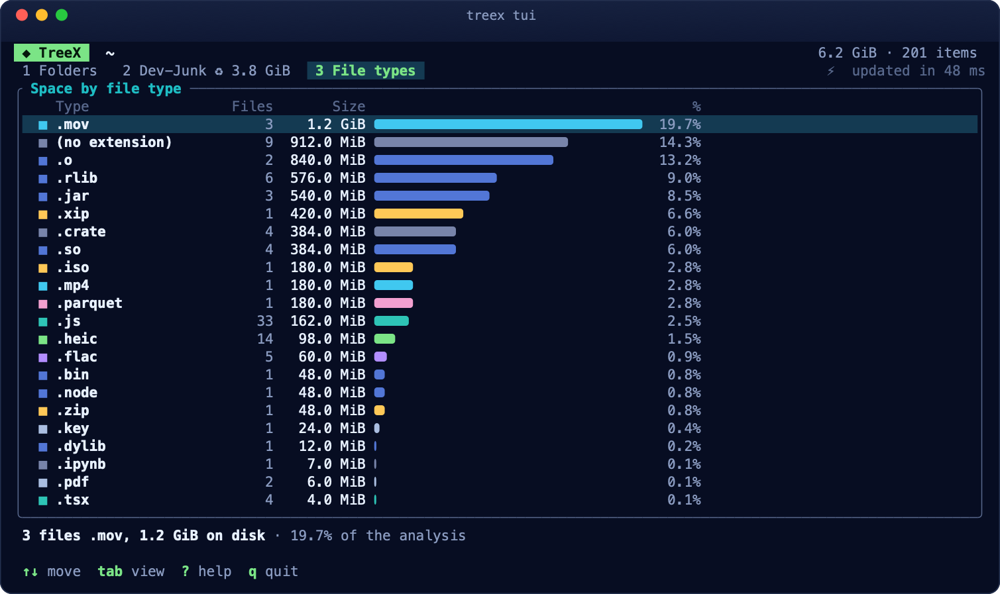
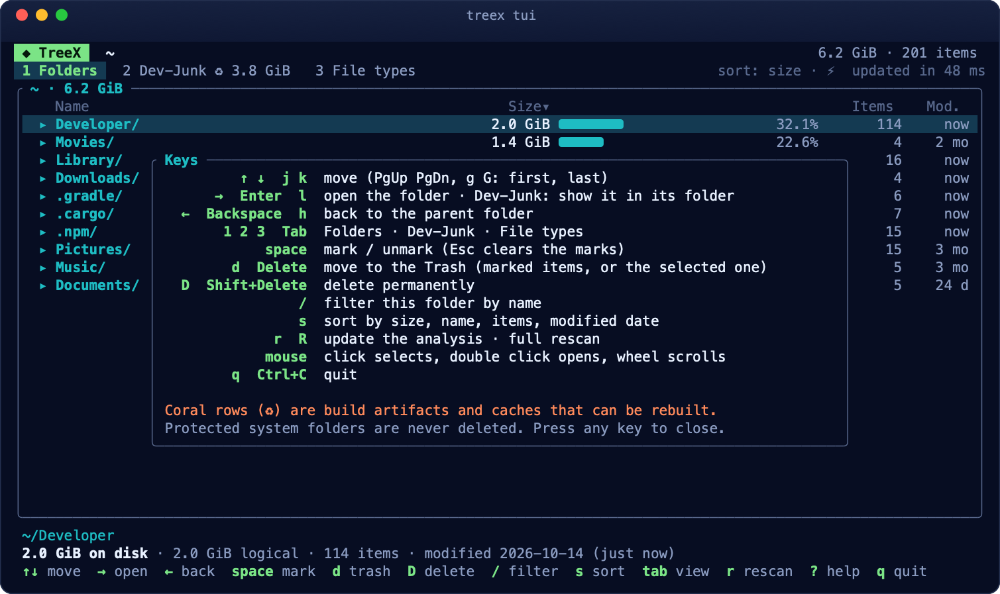
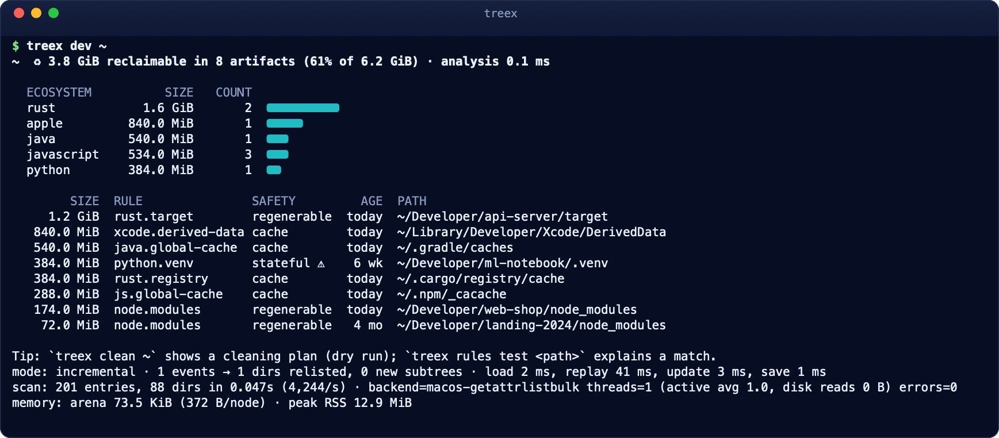
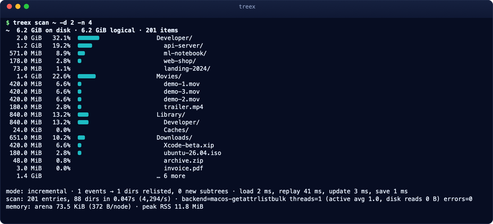
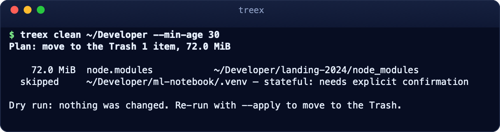

<p align="center"></p>

<h1 align="center">TreeX</h1>
<p align="center"><b>English</b> · <a href="README.it.md">Italiano</a></p>
<p align="center"><b>The disk analyzer for developers.</b> Blazing fast, build-artifact aware, and a pleasure to explore.</p>
<p align="center"><a href="https://github.com/kikoz85/TreeX/releases/latest"></a> <a href="https://www.enricofanucchi.com/en/app/treex?utm_source=github&utm_campaign=readme"></a> <a href="https://github.com/sponsors/kikoz85"></a> </p>

<p align="center"></p>

---

TreeX scans millions of files in seconds using each operating system's native APIs. It recognizes the space wasted by `node_modules`, `target/`, `DerivedData`, `.venv`, and Gradle or package-manager caches. It shows everything as a 2D / 2.5D isometric treemap that you can explore as well as read.

> **TreeX 1.0 runs on macOS, Windows and Linux.** macOS 13 Ventura or later (Apple Silicon and Intel), Windows 10/11 (x64), Linux (x86_64). Same app, same views, same commands everywhere.

### Dev-Aware: find the space you can take back

<p align="center"></p>

Run `treex dev ~`, or press `4` in the app. `node_modules`, `target`, Flutter builds, `DerivedData`, `vendor`, virtualenvs, and the npm, pip, and Homebrew caches rise as coral towers. Each tower shows the command that recreates it and how long its project has been idle. TreeX recognizes 16 development ecosystems plus system caches, and you can customize the rules in TOML.

| Home | 2D with semantic zoom | Search everything (⌘K) |
|---|---|---|
|  |  |  |

## Why 1.0 (after 0.10.2)

TreeX jumped from 0.10.2 straight to **1.0.0** because we consider it working and stable on all three systems, not because a feature list was ticked off:

- **Same app everywhere**: macOS, Windows and Linux have the same views, the same commands and the same safety rules, built and tested on real machines (a Mac, a Windows 11 PC, a Debian 13 machine), not only in CI.
- **Tested**: the whole test suite passes on all three systems, including real-GPU rendering tests, incremental updates compared against full scans, and deletion tests that try to trick TreeX (swapped folders, symlinks, protected paths).
- **Fast, measured**: the fastest of every tool we compared on each system, with the numbers below.
- **Safe by design**: everything goes to the Trash by default, every item is checked again right before it is touched, system and home folders are always protected, and every cleaning is logged.
- **Hardened by real use**: the 0.10.x releases fixed what came up while using TreeX every day (layout on small screens, panel closing, Full Disk Access, progress while updating an analysis).

1.0 does **not** mean everything is done. Code signing (so macOS and Windows stop asking for confirmation on first launch), app-store packages and a few engine improvements continue in the 1.x releases; the terminal UI, `treex tui`, arrived in 1.3. From 1.0 on, the command-line interface and the analysis file format change only in a compatible way within 1.x.

## Performance

TreeX uses each system's own fast path: `getattrlistbulk` on macOS, `getdents64` + `statx` on Linux, `GetFileInformationByHandleEx` on Windows, and on a whole NTFS drive (as administrator) it reads the Master File Table directly.

### macOS

Apple M4, macOS, same trees for every tool (hyperfine, 5 runs).

**From the second scan on**, TreeX doesn't rescan. It loads its snapshot, asks macOS (FSEvents) what changed, and re-reads only that.

| | **treex (second scan)** | treex (first scan) | dua | du |
|---|---|---|---|---|
| fixture, 324k entries | **0.05 s** | 0.35 s | 0.48 s | 0.80 s |
| deep fixture, 1M entries | **0.06 s** | 1.99 s | 1.97 s | 12.14 s |
| wide fixture, 1M entries | **0.05 s** | 1.48 s | 1.55 s | 4.60 s |
| `/Applications` (808k entries) | **0.06 s** | 1.70 s | 1.56 s | 8.60 s |

Even on a first scan, TreeX matches or beats the fastest competitor (`dua`). It is 1.7–2.5× faster than pdu, ncdu, dust, and gdu.

### Linux

Intel N95, ext4, Debian 13, warm cache (hyperfine, 5 runs). TreeX is the fastest on every tree:

| | **treex** | pdu | gdu | dust | dua | du |
|---|---|---|---|---|---|---|
| fixture, 324k entries | **0.21 s** | 0.28 s | 0.47 s | 0.44 s | 0.59 s | 0.69 s |
| deep fixture, 1M entries | **0.66 s** | 0.88 s | 1.35 s | 1.51 s | 1.69 s | 2.28 s |
| `/usr` | **0.29 s** | 0.33 s | 0.51 s | 0.49 s | 0.57 s | 0.84 s |
| home, 3.8M entries | **2.82 s** | 3.64 s | 4.73 s | 6.14 s | 7.07 s | 9.33 s |

### Windows

Windows 11, 8 cores, SATA SSD, NTFS, as administrator, warm cache (hyperfine). TreeX is the fastest on every tree:

| | **treex** | gdu | dua | pdu | dust |
|---|---|---|---|---|---|
| fixture, 324k entries | **0.56 s** | 0.76 s | 0.87 s | 6.20 s | 6.74 s |
| `C:\Program Files` | **0.50 s** | 0.76 s | 0.90 s | 3.76 s | 4.02 s |
| `C:\Users`, 703k entries | **2.68 s** | 2.86 s | 3.31 s | 15.03 s | 16.73 s |
| whole `C:` drive, 1.56M entries | **5.82 s** | 11.29 s | 12.53 s | 27.96 s | 32.19 s |

From the second analysis on, the USN change journal updates the whole `C:` drive in **0.2 s**.

While the app is open, the map **updates live** on all three systems: TreeX re-reads only the folders that changed (FSEvents on macOS, the USN journal and `ReadDirectoryChangesW` on Windows, inotify on Linux).

### Smooth on any GPU

The 2.5D city runs on the GPU. TreeX measures every frame: on powerful GPUs it keeps full 4× antialiasing, and only when a huge map is too heavy for a small integrated GPU does it lower antialiasing to stay smooth. On an Intel UHD 620 laptop, a 143,000-block map runs at 60 fps in 2D and 2.5D.

### Safe cleaning

Pick items in the Dev-Junk panel (or run `treex clean --apply`), confirm, and watch the towers **sink**. Right before deleting each folder, TreeX checks it again:

- it is still the same folder;
- it is not a symlink;
- its project markers are still there;
- there is no git repository inside.

By default, items go to the **Trash**. Every operation is logged (`treex history`).

| Pick | Confirm | Done |
|---|---|---|
|  |  |  |

### File types and duplicates

Press `T` to see where the space goes **by file extension**. Click a type and only its files stay lit in the map, in 2D and 2.5D. Press `U` to **find duplicate files**: TreeX compares sizes first, then the beginning and end of each file, and reads whole contents only for files that still match. Build artifacts are left out by default, since they are full of identical package files. Pick which copy to keep (the oldest by default) and delete the others: each one is compared again with the copy kept right before it goes. From the terminal, use `treex types` and `treex dupes --delete`.

| File types (`T`) | Duplicates (`U`) |
|---|---|
|  |  |

### Every file, every volume, any deletion

- **File list** (`L`): every file or folder of the analysis, with wildcard search (`*.mov`, `Downloads/*.dmg`), size and age filters, sortable columns and **CSV / JSON export** (`treex export`).
- **Delete anything**: ⌘-click to select, then ⌘⌫ to move to the Trash, or ⌥⌘⌫ to delete permanently. TreeX checks each item again right before touching it, never follows symlinks, and always refuses system locations and your top-level folders (`treex delete`).
- **Right-click** for Quick Look, Open with, Get Info, Show in Finder and more.
- **This Mac / This PC / This computer**: your disks, external drives, disk images and network shares, with their free space (`treex volumes`).
- **Save an analysis** (⌘S) and reopen it later, or on another Mac, without rescanning (⇧⌘O, `--save` / `--from`).

### More than a disk map

- **What changed?** (`C`, `treex diff`): TreeX quietly keeps the previous analysis of every folder, so it can tell you what is new, what grew and what was removed since yesterday — no saving needed.
- **APFS clones**: copies made on the same volume often share their blocks. TreeX shows the space a deletion **really** frees, marks clone copies among duplicates and never promises space that won't come back.
- **Purgeable space**: each volume shows what macOS will free by itself (caches, local Time Machine snapshots, downloaded iCloud files).

<p align="center"></p>

| File list (`L`) | Delete with confirmation |
|---|---|
|  |  |

## Command line: `treex`

TreeX is also a complete command-line tool: the same engine, the same Dev-Aware rules and the same safety checks as the app, on macOS, Windows and Linux, and on headless servers over SSH. It ships inside every app package and on its own, installs as a system command, and comes with manual pages (`man treex`) and Tab completion.

### Interactive: `treex tui`

<p align="center"></p>

Explore a folder as in the app, inside the terminal:

- **Folders** by size, with bars, item counts and age. Arrows move, → opens, ← goes back; the mouse works too (click, double click, wheel).
- **Dev-Junk** (`2`): every build artifact and cache that can be rebuilt (`node_modules`, `target`, `.venv`, DerivedData, npm, Cargo and Gradle caches…), with its ecosystem and how long its project has been idle. Mark with space, `d` moves them to the Trash.
- **File types** (`3`): the space by extension, in the app's colors.
- **Safe deletion**: `d` to the Trash, `D` permanently, always after a confirmation; each item is checked again right before it goes, and protected system folders are never touched.
- **The app's look**: Aurora colors in 24-bit where the terminal supports them, the 256-color palette otherwise, none with `NO_COLOR`.

| Dev-Junk (`2`) | File types (`3`) |
|---|---|
|  |  |
| **Delete with confirmation** | **Every key (`?`)** |
|  |  |

| Key | Action |
|---|---|
| `↑` `↓` `j` `k` · `PgUp` `PgDn` · `g` `G` | move · page · first, last |
| `→` `Enter` / `←` `Backspace` | open the folder / back to the parent |
| `1` `2` `3` `Tab` | Folders · Dev-Junk · File types |
| `space` · `Esc` | mark / unmark · clear the marks |
| `d` · `D` | move to the Trash · delete permanently (both ask first) |
| `/` · `s` | filter by name · sort by size, name, items or date |
| `r` · `R` | update the analysis · rescan everything |
| `?` · `q` | every key · quit |

### Reports and scripts

Every analysis is also a command that prints a report; most of them add `--json` for scripts. Like the app, a command reuses the previous analysis of the same folder, so the second run takes a fraction of a second.

<p align="center"></p>

| `treex scan` | `treex clean` (dry run) |
|---|---|
|  |  |

| Command | What it does |
|---|---|
| `treex tui [PATH]` | the interactive explorer above |
| `treex scan [PATH]` | the largest entries, `-d` levels deep, `-n` per level; `--json` |
| `treex dev [PATH]` | build artifacts and caches you can regenerate, by ecosystem; `--json` |
| `treex clean [PATH]` | the cleaning plan (dry run); `--apply` moves to the Trash; `--permanent`, `--min-age DAYS`, `--ecosystem`, `--rule` |
| `treex types [PATH]` | space by file extension; `--json` |
| `treex dupes [PATH]` | duplicate files; `--delete --keep oldest\|newest\|shortest` removes the extra copies (dry run unless `--apply`); `--json` |
| `treex export [PATH]` | every file as CSV or JSON (`-o`, `--format`), filtered with `--name`, `--ext`, `--min-size`, `--older-than`… |
| `treex delete PATH…` | to the Trash (or `--permanent`) with safety checks |
| `treex diff [PATH]` | what changed since the previous analysis, or `--against` a saved one; `--json` |
| `treex volumes` | the mounted disks with their space; `--json` |
| `treex history` | the cleanings done, with their space |
| `treex rules list \| check \| test` | inspect, validate and debug the Dev-Aware rules |
| `treex completions SHELL` | the Tab-completion script for bash, zsh, fish, PowerShell, elvish |

Every command is described in its own manual page (`man treex-scan`, `man treex-clean`…) and in `treex <command> --help`; the full reference, in Italian, is in [docs/user/cli.md](docs/user/cli.md).

### `treex` as a system command

| System | How |
|---|---|
| **macOS** | With Homebrew the cask installs `treex` too, with its manual pages and completions. From the DMG: in the app, ⌘K → *Install the treex command in the terminal*. Command line only: `treex-cli-<version>-macos-universal.tar.gz` → `./install.sh` |
| **Linux** | Debian, Ubuntu: `sudo apt install ./treex_<version>_amd64.deb`. Fedora, RHEL, openSUSE: `sudo dnf install ./treex-<version>-1.x86_64.rpm`. Any distribution, servers included: `treex-cli-<version>-linux-x86_64.tar.gz` → `./install.sh` (`--user`: no root). AppImage: Ctrl+K → *Install the treex command* in the app |
| **Windows** | `treex-cli-<version>-windows-x64.zip` → double-click `install.cmd` (adds `treex` to your PATH, no administrator). From the app: Ctrl+K → *Install the treex command* |

Then `man treex` (macOS, Linux) or `treex --help`, and Tab completion in bash, zsh, fish and PowerShell. To remove it: `./install.sh --uninstall`, `sudo apt remove treex`, `sudo dnf remove treex`, `install.cmd -Uninstall`. The copy inside the app updates with the app; the standalone packages update by installing the new version over the old one.

## Install

From the [releases](https://github.com/kikoz85/TreeX/releases):

- **macOS**: open `TreeX-<version>-macos-universal.dmg`, drag **TreeX** into Applications. The `treex` command-line tool ships inside the app.
- **Windows**: unzip `TreeX-<version>-windows-x64.zip` and run **TreeX.exe** (the command-line tool is `bin\treex.exe`). Run as administrator for the fastest whole-drive analysis (Master File Table) and instant re-analysis (USN journal).
- **Linux**: `TreeX-<version>-x86_64.AppImage` (one file, runs on most distributions), `TreeX-<version>-x86_64.flatpak` (`flatpak install --user …`), or `treex-<version>-linux-x86_64.tar.gz` with `./install.sh` (no root needed).
- **Command line only** (servers too): `treex-cli-<version>-…` for each system, `treex_<version>_amd64.deb` and `treex-<version>-1.x86_64.rpm`, see [`treex` as a system command](#treex-as-a-system-command).

First-launch steps, Homebrew and uninstalling: [docs/user/install.md](docs/user/install.md).

**Updating**: click **Updates** in the bottom-right corner of the home screen (or ⌘K → *Check for updates*). TreeX asks GitHub for the latest release and, if you choose to update, downloads it, checks its digital signature, replaces itself and restarts. Flatpak can't update apps itself: install the new `.flatpak` file.

## Quick start

```bash
treex tui ~                      # explore interactively (arrows, ? for every key)
treex scan ~/Developer -d 2      # sizes, two levels deep
treex dev ~                      # build artifacts and caches you can reclaim
treex clean ~/Developer          # dry run; add --apply to move them to the Trash
treex types ~                    # space by file extension
treex dupes ~/Pictures           # duplicate files (≥ 1 MiB by default)
treex export ~ --name '*.mov' -o movies.csv   # every .mov, as CSV
treex delete ~/Downloads/old.iso # to the Trash, with safety checks
treex diff ~/Developer           # what changed since the previous analysis
```

In the app:

- `Tab` switches between 2D and 2.5D; in 2.5D, ↺ ↻ (or `Q` / `E`) turn the city, as do two fingers on a Mac trackpad;
- the scroll wheel zooms into detail;
- `⌘K` searches everything;
- `4` turns on Reclaim mode;
- `T` shows file types, `U` finds duplicates, `L` lists every file and `C` shows what changed;
- ⌘-click selects, ⌘⌫ moves to the Trash, right-click opens the menu (on Windows and Linux: `Ctrl`-click, `Delete`).

## Documentation

The user guides are in [`docs/`](docs/README.md) (in Italian): installation, the app, the command line, configuration and macOS permissions. What changed in each version is in the [release notes](https://github.com/kikoz85/TreeX/releases).

TreeX uses the network only when you click **Updates**: one request to GitHub for the latest release, plus the download if you choose to update. Nothing about you or your disk is sent. Scans read only metadata (names, sizes, dates). File contents are read only when you start a duplicate search, and only for files that share their size with another one.

## Support TreeX

TreeX is free. If it saved you some gigabytes (or some time), you can support its development on **[GitHub Sponsors](https://github.com/sponsors/kikoz85)**. Sponsorships pay for what a free app needs to grow:

- code-signing certificates, so macOS and Windows stop asking for confirmation on first launch;
- app-store packages (Homebrew, winget, Flathub);
- test machines for the three systems, and the time to keep TreeX the fastest of its kind.

<p align="center"><a href="https://github.com/sponsors/kikoz85"></a></p>

You can also find the **♥ Support TreeX** button in the bottom-right corner of the app's home screen. Starring the repository and telling other developers about TreeX helps too.

## License

Your choice of [MIT](LICENSE-MIT) or [Apache-2.0](LICENSE-APACHE). Dependency licenses are listed in [THIRD_PARTY_LICENSES.md](THIRD_PARTY_LICENSES.md).
