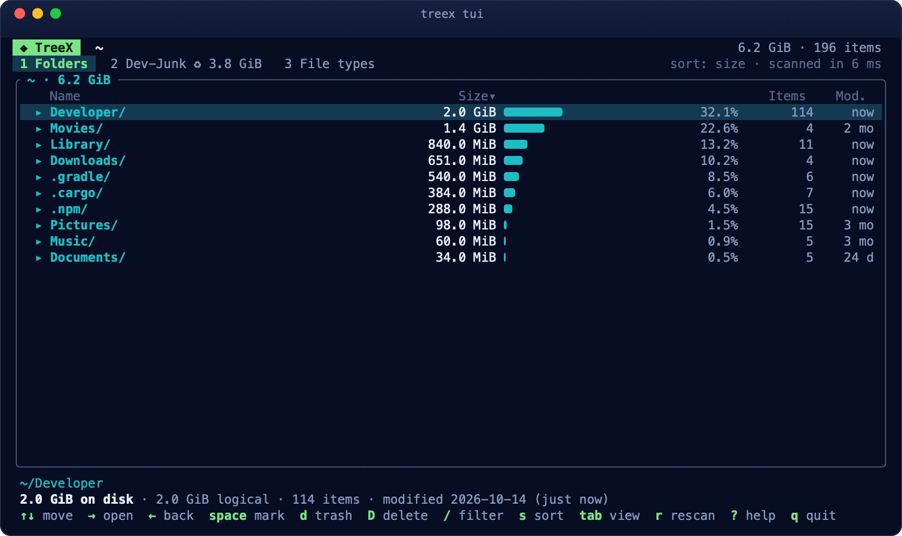
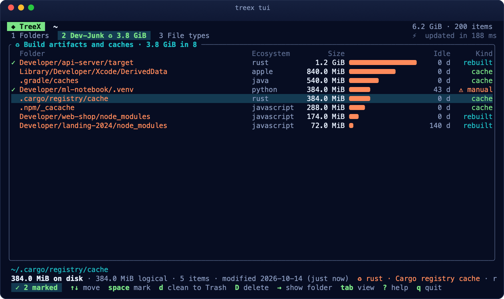
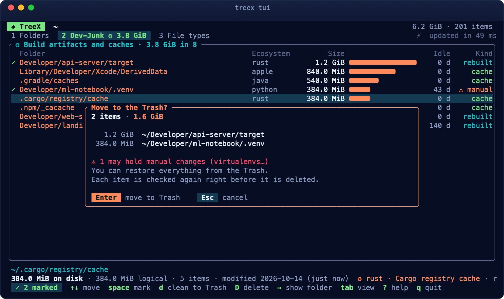

# Riferimento CLI

## Installare `treex` come comando

`treex` è incluso in ogni pacchetto di TreeX; per usarlo da qualsiasi terminale (anche via SSH su un server):

| Sistema | Come |
|---|---|
| **macOS** | **Homebrew** (`brew install --cask ./treex.rb`): installa anche `treex`, le pagine `man` e i completamenti. Dal **DMG**: nell'app, ⌘K → *Installa il comando treex nel terminale* (collega `/usr/local/bin/treex` alla copia dentro l'app; macOS chiede la password se serve). **Solo riga di comando**: `treex-cli-<ver>-macos-universal.tar.gz`, poi `./install.sh` (in `/usr/local`; `--user` per `~/.local`) |
| **Linux** | **Debian, Ubuntu**: `sudo apt install ./treex_<ver>_amd64.deb` (`/usr/bin/treex`, `man`, completamenti). **Fedora, RHEL, openSUSE**: `sudo dnf install ./treex-<ver>-1.x86_64.rpm` (o `zypper install`), stessi file. **Qualsiasi distribuzione**: `treex-cli-<ver>-linux-x86_64.tar.gz`, poi `./install.sh` (`--user`: in `~/.local`, senza root). **AppImage**: nell'app, Ctrl+K → *Installa il comando treex* (crea `~/.local/bin/treex`). **Flatpak**: `flatpak run --command=treex dev.treex.TreeX` (conviene un alias) |
| **Windows** | **Installer** dell'app (`TreeX-<ver>-windows-x64-setup.exe`): l'opzione *Aggiungi il comando treex al PATH*, spuntata per default. **Solo riga di comando**: `treex-cli-<ver>-windows-x64.zip`, poi doppio clic su `install.cmd`: copia `treex.exe` in `%LOCALAPPDATA%\Programs\TreeX CLI` e lo aggiunge al PATH dell'utente, senza amministratore (`install.cmd -Uninstall` per toglierlo). Dall'app: Ctrl+K → *Installa il comando treex* (aggiunge al PATH la cartella `bin` accanto a `TreeX.exe`) |

Disinstallare: `./install.sh --uninstall` (con le stesse opzioni dell'installazione), `sudo apt remove treex`, `sudo dnf remove treex`, `install.cmd -Uninstall`.

In una pipe (`treex scan ~ | head`) `treex` si ferma in silenzio quando il comando che legge ha finito, come gli altri strumenti Unix.

**Manuale**: `man treex` (macOS e Linux) descrive tutti i comandi, con esempi, file e variabili d'ambiente; ogni comando ha la sua pagina: `man treex-tui`, `man treex-scan`, `man treex-clean`, `man treex-rules-check`… Ovunque: `treex --help`, `treex <comando> --help`.

**Completamento con Tab** per bash, zsh e fish: installato da `install.sh`, dai pacchetti `.deb` e `.rpm`, da Homebrew e dal comando dell'app. Altrimenti `treex completions <bash|zsh|fish|powershell|elvish>` stampa lo script; ad esempio in PowerShell aggiungi al profilo (`notepad $PROFILE`) la riga `. "$env:LOCALAPPDATA\Programs\TreeX CLI\treex-completion.ps1"` (il file lo copia `install.cmd`; non si chiama `treex.ps1` perché PowerShell lo eseguirebbe al posto di `treex.exe`).

## `treex tui [PATH]`

L'analisi in modo **interattivo, nel terminale**: stesso motore, stesse regole Dev-Aware e stessi controlli di sicurezza dell'app, senza finestre. Funziona in qualsiasi terminale di macOS, Windows (Windows Terminal, PowerShell) e Linux, anche **via SSH** su un server senza interfaccia grafica. Senza `PATH` analizza la cartella corrente.



All'avvio mostra l'analisi in corso (file, cartelle e spazio contati dal vivo; se esiste un'analisi precedente della stessa cartella la aggiorna invece di rifarla). Poi tre viste:

- **1 Folders**: il contenuto della cartella per dimensione, con barra della quota, percentuale, elementi e ultima modifica. Le cartelle sono in ottanio (▸), i file con il pallino del colore della loro categoria (come nell'app), gli **artefatti di build** in corallo (♻) con il loro ecosistema. Sotto, il percorso completo e i dettagli dell'elemento selezionato (spazio su disco e logico, elementi, data di modifica; per un artefatto la regola e il comando che lo ricrea).
- **2 Dev-Junk**: tutti gli artefatti e le cache che si possono ricreare, dal più grande, con ecosistema, giorni di inattività del progetto e tipo (*cache*, *rebuilt*; ⚠ *manual* per quelli che possono contenere modifiche a mano, come i virtualenv). → mostra l'artefatto nella sua cartella.
- **3 File types**: lo spazio per estensione, con i colori delle categorie.



| Tasto | Azione |
|---|---|
| `↑` `↓` / `j` `k` | muoversi (`PgUp` `PgDn`, `g` `G`: primo, ultimo) |
| `→` `Invio` `l` | aprire la cartella · in Dev-Junk: mostrarla nella sua cartella |
| `←` `Backspace` `h` | tornare alla cartella superiore |
| `1` `2` `3` `Tab` | Folders · Dev-Junk · File types |
| `spazio` | selezionare / deselezionare (`Esc` toglie le selezioni) |
| `d` `Canc` | spostare nel Cestino gli elementi selezionati (o quello sotto il cursore) |
| `D` `Maiusc+Canc` | eliminare definitivamente |
| `/` | filtrare la cartella per nome (`Invio` tiene il filtro, `Esc` lo toglie) |
| `s` | ordinare per dimensione, nome, elementi, data di modifica |
| `r` `R` | aggiornare l'analisi · rianalizzare tutto |
| `?` | tutti i tasti |
| `q` `Ctrl+C` | uscire |

Anche il **mouse**: clic per selezionare, doppio clic per aprire, rotella per scorrere, clic sulle schede.

**Eliminare** chiede sempre conferma, con l'elenco, lo spazio e gli avvisi (cartelle con un repository git, artefatti *manual*):



Gli elementi normali passano dagli stessi controlli di `treex delete` (cartelle di sistema e della home protette, identità ricontrollata un istante prima), gli artefatti da quelli di `treex clean` (regola ricontrollata sul disco). Tutto finisce nello storico (`treex history`). Se lo spostamento nel Cestino non riesce (ad esempio su alcuni dischi di rete), TreeX lo dice e lascia l'elemento dov'è: `D` lo elimina definitivamente.

**Colori**: quelli dell'app (sfondo blu notte, menta, ottanio, corallo) a 24 bit dove il terminale li supporta (`COLORTERM=truecolor`, Windows Terminal, iTerm2, WezTerm, VS Code…), altrimenti i più vicini della tavolozza a 256 colori; `NO_COLOR=1` li toglie.

Accetta le opzioni di analisi di `treex scan`: `--fresh`, `--from <FILE>` (esplora un'analisi salvata), `--save`, `--cross-mounts`, `-j`.

## `treex scan [PATH]`

Scansiona `PATH` (default: directory corrente) e stampa le voci più grandi per spazio allocato.

| Opzione | Default | Descrizione |
|---|---|---|
| `-d, --depth <N>` | `1` | livelli dell'albero da stampare |
| `-n, --top <N>` | `15` | voci mostrate per livello (le altre vengono riassunte in "… N more") |
| `--backend <auto\|portable\|native\|mft>` | `auto` | `native` = API bulk del sistema operativo (macOS: `getattrlistbulk`; Windows: `GetFileInformationByHandleEx`; Linux: `getdents64` + `statx`); `mft` = Windows, lettura diretta della Master File Table di un disco NTFS (amministratore); `portable` = `read_dir` + `lstat`, disponibile ovunque. `auto` = `native`, e su Windows la MFT quando si analizza un'unità intera da amministratore |
| `-j, --threads <N>` | `0` (adattivo) | thread di scansione. `0` = concorrenza adattiva: TreeX misura le letture dal disco e il throughput e regola il parallelismo durante la scansione. Un valore esplicito fissa il pool a N thread |
| `--cross-mounts` | off | entra anche nei filesystem montati sotto `PATH` |
| `--stats-only` | off | stampa solo le statistiche (per i benchmark) |
| `--json` | off | stampa solo le statistiche come un unico oggetto JSON (per gli script) |
| `--fresh` | off | ignora lo snapshot salvato e fa una scansione completa (poi salva un nuovo snapshot) |
| `--no-snapshot` | off | non legge né scrive snapshot: sempre scansione completa, nessun file in cache |
| `--snapshot <FILE>` | cache utente | usa questo file di snapshot invece di quello predefinito |
| `--save <FILE>` | — | salva anche l'analisi in un file `.treex` (da riaprire con `--from` o nell'app con ⇧⌘O) |
| `--from <FILE>` | — | non scansiona: usa un'analisi salvata (`PATH` viene ignorato). Vale per tutti i comandi che analizzano |

### Scansioni istantanee dalla seconda volta (macOS e Windows)

La prima scansione di una directory salva uno **snapshot** nella cache utente. Dalla volta successiva TreeX legge lo snapshot e chiede al sistema cosa è cambiato da allora, anche se nel frattempo TreeX non era in esecuzione, e rilegge solo le directory modificate:
- **macOS**: FSEvents. Un albero da 1M di file passa da ~2 s a **0,04–0,1 s**.
- **Windows**: il journal USN di NTFS (serve l'amministratore, che può leggere il volume). La seconda analisi di `C:` scende a **0,2 s**.
- **Linux**: non c'è un journal delle modifiche leggibile senza privilegi, quindi ogni analisi è completa (resta la più veloce, vedi i benchmark).

La riga `mode:` dice cosa è successo:

```
mode: incremental · 3 events → 2 dirs relisted, 0 new subtrees · load 16 ms, replay 27 ms, update 21 ms, save 44 ms
mode: full (no snapshot yet) · save 54 ms
```

Se qualcosa non torna (snapshot corrotto, volume diverso, cronologia di macOS azzerata, troppe modifiche…) TreeX fa da solo una scansione completa e ne indica il motivo. Il risultato incrementale è sempre identico a quello di una scansione completa.

Gli snapshot (~53 byte per file o cartella scansionati) si possono cancellare in qualsiasi momento. Si trovano in:
- macOS: `~/Library/Caches/dev.treex.TreeX/snapshots/`
- Windows: `%LOCALAPPDATA%\TreeX\cache\snapshots\`
- Linux: `~/.cache/treex/snapshots/` (o `$XDG_CACHE_HOME/treex/`)

### Comportamento
- I **symlink** non vengono seguiti e contano solo per la loro dimensione.
- Gli **hard link** vengono contati una sola volta.
- I **mount point** (altri dischi, immagini disco, condivisioni di rete, i volumi di sistema sotto `/System/Volumes`) vengono saltati, salvo `--cross-mounts`.
- Analizzando **`/`** su macOS si vedono il volume di sistema e, attraverso i firmlink (`/Users`, `/Applications`…), il volume dati, ciascuno una sola volta. `/` è sempre una scansione completa (niente aggiornamento incrementale); per il disco di avvio è più rapido `treex scan /System/Volumes/Data`, che usa lo snapshot.
- Su **Windows** le giunzioni e i collegamenti simbolici (reparse point) non vengono seguiti; le cartelle di sistema illeggibili senza amministratore vengono contate in `errors`. Analizzando un'unità intera (`C:\`) da amministratore TreeX legge la Master File Table; se non può (niente privilegi, file system diverso da NTFS) usa lo scanner nativo e lo dice con una riga `note:`.
- Le directory illeggibili vengono contate in `errors` e la scansione prosegue.

### Esempi

```bash
treex scan ~ -d 2
```

```bash
treex scan /Volumes/External --cross-mounts
```

```bash
treex scan ~/Developer --stats-only --backend portable
```

```bash
treex scan ~/Developer --json
```

Esempio di output JSON (le chiavi esistenti sono stabili). `active_avg` è il parallelismo medio scelto dal governor; `disk_read_bytes` sono i byte letti fisicamente dal disco durante la scansione: 0 significa che i metadati erano tutti in cache. Su macOS seguono le chiavi della cache: `mode` (`full` o `incremental`), `full_reason`, `events`, `dirty_dirs`, `new_subtrees`, `load_ms`, `replay_ms`, `update_ms`, `save_ms`. `seconds` esclude il salvataggio dello snapshot.

```json
{"version":"0.1.0","path":"/Users/me/.cargo","backend":"macos-getattrlistbulk","threads":12,"active_avg":4.00,"disk_read_bytes":0,"entries":60606,"dirs":8065,"errors":0,"seconds":0.191737,"entries_per_sec":316090,"alloc_bytes":1121759232,"logical_bytes":993057963,"arena_bytes":4219856,"peak_rss_bytes":10780672}
```

## `treex dev [PATH]`

Trova gli artefatti di build e le cache rigenerabili sotto `PATH` (default: la cartella corrente). Usa la stessa scansione di `treex scan`, snapshot incluso, quindi dalla seconda volta è istantaneo.

| Opzione | Default | Descrizione |
|---|---|---|
| `--min-age <DAYS>` | `0` | solo progetti fermi da almeno N giorni |
| `--ecosystem <NOME>` | tutti | `rust`, `javascript`, `python`, `apple`, `java`, `cpp`, `dart`, `php`, `go`, … |
| `-n, --top <N>` | `20` | artefatti elencati |
| `--json` | off | output macchina (`total_bytes`, `ecosystems[]`, `artifacts[]` con path, regola, sicurezza, età, comando di rigenerazione) |
| `--fresh`, `--no-snapshot`, `-j` … | | come `treex scan` |

Esempio reale (home dello sviluppatore, 4,86M di elementi):

```
~  ♻ 15.6 GiB reclaimable in 97 artifacts (3% of 516.1 GiB) · analysis 12.7 ms

  ECOSYSTEM          SIZE   COUNT
  rust            7.6 GiB       4  ████████████
  dart            3.4 GiB       4  █████
  system          2.0 GiB       1  ███
  php             1.3 GiB      69  ██
  …
        SIZE  RULE                   SAFETY         AGE  PATH
     4.2 GiB  rust.target            regenerable  today  ~/Desktop/TreeX/target
     2.0 GiB  homebrew.cache         cache        today  ~/Library/Caches/Homebrew
     …
   102.0 MiB  python.venv            stateful ⚠    6 mo  ~/git/subito-telegram-bot/.venv
```

`stateful ⚠` indica che la cartella potrebbe contenere modifiche manuali (per esempio un virtualenv): da verificare prima di cancellarla.

Su macOS, quando un artefatto è fatto di **cloni APFS** (i simulatori di Xcode, copie fatte con `cp -c`), eliminarlo libera solo la parte che non condivide: `treex dev` lo dice con una riga "≥ X really freed" sotto il totale e una colonna `FREES ≥` (nel JSON `freeable_bytes`, `null` fuori da macOS), calcolate solo per gli artefatti trovati. Il valore è un minimo: se alcuni file sono cloni l'uno dell'altro (anche in artefatti diversi), eliminati insieme liberano anche i blocchi che condividono, e TreeX lo dice ("maybe more", un `+` accanto alla cifra, `may_free_more` nel JSON). Se invece alcuni file sono cloni di file non elencati, i dati che condividono restano sul disco: TreeX lo dice e non promette di più (`clones_outside` nel JSON). Per i file compressi da macOS e i cloni modificati non si può sapere, e resta il solo minimo.

## `treex clean [PATH]`

Pulisce gli artefatti trovati da `treex dev`, in sicurezza. **Senza `--apply` non tocca nulla** e mostra solo il piano (dry run).

| Opzione | Descrizione |
|---|---|
| `--apply` | esegue davvero (chiede conferma su terminale) |
| `--permanent` | elimina definitivamente invece di spostare nel Cestino |
| `--include-stateful` | include gli elementi "da verificare" (es. virtualenv), esclusi per default |
| `--min-age <DAYS>`, `--ecosystem <NOME>`, `--rule <ID>` (ripetibile) | filtri |
| `-y, --yes` | niente domanda di conferma (obbligatorio fuori da un terminale) |

```
$ treex clean ~/Developer --min-age 30
Plan: move to the Trash 12 items, 8.4 GiB
     4.2 GiB  rust.target            ~/Developer/old-api/target
     …
  skipped     ~/Developer/ml/.venv — stateful: needs explicit confirmation

Dry run: nothing was changed. Re-run with --apply to move to the Trash.
```

Prima di toccare ogni cartella TreeX ricontrolla che sia ancora quella analizzata: stesso inode, non un symlink, marker della regola ancora presenti, nessun `.git`, nessuna protezione. Ciò che è cambiato dopo l'analisi viene **saltato** e segnalato (`refused`). Con il Cestino lo spazio si libera quando lo svuoti.

## `treex history [-n N]`

Lo storico delle pulizie: quando, modalità (Cestino / definitiva), dimensione, regola, percorso ed eventuale motivo di un rifiuto.

## `treex rules`

| Comando | Descrizione |
|---|---|
| `treex rules list [PATH]` | regole attive (integrate, utente, `.treex.toml` del progetto) con cosa riconoscono |
| `treex rules check [FILE]` | valida un file di regole (default: file utente e `./.treex.toml`); exit code 1 se ci sono errori |
| `treex rules test <PATH>` | spiega perché una cartella è (o non è) un artefatto, marker per marker |

```
$ treex rules test ~/progetto/target
  rule `rust.target` (Cargo target directory): name ✓
      sibling_any: Cargo.toml ✗ → ✗
      contains_any: CACHEDIR.TAG ✗, .rustc_info.json ✗, debug ✗, release ✗ → ✗
  …
  NO     no rule has all its markers here
```

## `treex types [PATH]`

Lo spazio **per estensione**, dalla più pesante. Nessuna lettura oltre alla scansione: è un solo passaggio sull'albero in memoria. Le maiuscole non contano; i file senza estensione e i dotfile finiscono in `(none)`; gli hard link si contano una volta.

| Opzione | Default | Descrizione |
|---|---|---|
| `-n, --top <N>` | `25` | estensioni elencate (le altre vengono riassunte) |
| `--json` | off | `root`, `total_bytes`, `types[]` con `ext`, `files`, `bytes` (su disco), `logical_bytes` |
| `--fresh`, `--no-snapshot`, `-j` … | | come `treex scan` |

```
$ treex types ~/Desktop/TreeX -n 5
~/Desktop/TreeX  4.4 GiB in files · 36 extensions

  EXTENSION          SIZE       %       FILES
  .rlib           1.4 GiB   32.9%         580  ████████
  .rmeta          1.3 GiB   28.8%       1,283  ███████
  .o            937.3 MiB   21.0%       3,640  █████
  .bin          299.0 MiB    6.7%         221  ██
  (none)        238.4 MiB    5.3%       3,418  █
  … 31 more     205.0 MiB               6,232
```

## `treex dupes [PATH]`

Trova i **file duplicati** (stesso contenuto in percorsi diversi), raggruppati e ordinati per spazio sprecato. Legge il meno possibile:

1. dimensione, dalla scansione (nessuna lettura): un file con dimensione unica non ha duplicati;
2. hash BLAKE3 dei primi e degli ultimi 16 KiB dei file con la stessa dimensione (l'intero file se più piccolo di 32 KiB);
3. hash completo solo dei file che coincidono ancora.

Gli hard link non sono duplicati (sono lo stesso file), i symlink non vengono seguiti, i file modificati dopo la scansione vengono saltati e contati a parte. Gli artefatti di build e le cache del motore Dev-Aware sono esclusi per default.

| Opzione | Default | Descrizione |
|---|---|---|
| `--min-size <SIZE>` | `1M` | ignora i file più piccoli; accetta byte o suffissi `K`, `M`, `G`, `T` (unità binarie: `500K`, `1.5G`) |
| `--include-artifacts` | off | cerca anche dentro `node_modules`, `target` e le altre cartelle riconosciute |
| `-n, --top <N>` | `20` | gruppi elencati |
| `--json` | off | `wasted_bytes`, `groups_count`, `files`, `candidates`, `bytes_read`, `skipped`, `seconds`, `groups[]` con `size`, `bytes_each`, `wasted_bytes`, `paths[]` |
| `--fresh`, `--no-snapshot`, `-j` … | | come `treex scan` |

Su un terminale l'avanzamento (file confrontati, byte letti) appare su stderr.

```
$ treex dupes ~/Desktop/TreeX --min-size 100K -n 1
~/Desktop/TreeX  ⧉ 2.5 MiB in duplicate copies · 2 groups, 8 files ≥ 100.0 KiB · 0.0s (3.7 MiB read)

  1.6 MiB wasted · 3 copies of 820.0 KiB
    ~/Desktop/TreeX/assets/icons/ios/AppIcon.appiconset/icon-1024.png
    ~/Desktop/TreeX/assets/icons/macos/AppIcon.appiconset/icon-512@2x.png
    ~/Desktop/TreeX/assets/icons/watchos/AppIcon.appiconset/watch-1024.png

  … 1 more groups, 912.0 KiB wasted (use -n)
```

Su APFS una copia può essere un **clone** che condivide i blocchi con l'originale: occupa spazio una volta sola, ed eliminarla libera poco o nulla. TreeX lo rileva (`ATTR_CMNEXT_PRIVATESIZE`): ogni gruppo dice quanto **si libera davvero** (`frees ≥ X`), le copie clonate sono marcate `(clone)` e i gruppi sono ordinati per spazio realmente liberabile. Nel JSON: `freeable_bytes` (totale e per gruppo), `clones`, `private_bytes` per copia.

```
  19.1 MiB wasted, frees ≥ 9.5 MiB · 3 copies of 9.5 MiB · 2 share blocks as APFS clones
    ~/Pictures/a.jpg  (clone)
    ~/Pictures/backup/a.jpg  (clone)
    ~/Pictures/old/a.jpg
```

### Eliminare le copie in più

| Opzione | Descrizione |
|---|---|
| `--delete` | mostra il piano: per ogni gruppo la copia tenuta (`keep`) e quelle da eliminare. **Senza `--apply` non tocca nulla** |
| `--keep <oldest\|newest\|shortest>` | quale copia tenere: la più vecchia (default, di solito l'originale), la più recente, quella col percorso meno annidato |
| `--apply` | esegue: ogni copia viene **confrontata di nuovo per intero** (BLAKE3) con quella tenuta un istante prima di eliminarla; se è cambiata viene saltata |
| `--permanent` | elimina definitivamente invece di spostare nel Cestino |
| `-y, --yes` | niente domanda di conferma (obbligatorio fuori da un terminale) |

```
$ treex dupes ~/Pictures --delete --keep oldest
  keep    ~/Pictures/2024/IMG_0001.jpg
  delete  ~/Pictures/backup/IMG_0001.jpg
  delete  ~/Pictures/old/IMG_0001 copy.jpg

Dry run: 2 copies (5.7 MiB) would be moved to the Trash. Re-run with --apply.
```

## `treex export [PATH]`

Esporta **tutti i file** (o le cartelle) dell'analisi in CSV o JSON, con filtri e ordinamento: l'equivalente da terminale della lista dei file dell'app.

| Opzione | Default | Descrizione |
|---|---|---|
| `--name <PATTERN>` | — | wildcard sul nome (`*.mov`, `IMG_????.jpg`); con una `/` sul percorso intero; senza wildcard: il nome contiene il testo. Senza distinzione di maiuscole |
| `--ext <EXT>` | — | solo questa estensione (`none` = senza estensione) |
| `--min-size`, `--max-size <SIZE>` | — | spazio su disco (`500K`, `10M`, `1G`…) |
| `--older-than`, `--newer-than <DAYS>` | — | non modificati da almeno N giorni / modificati negli ultimi N giorni |
| `--dirs`, `--all` | file | solo cartelle / file e cartelle |
| `--sort <size\|name\|modified\|type\|path>` | `size` | dimensione e data dal più grande / recente, gli altri A→Z |
| `--reverse` | off | inverte l'ordine |
| `-n, --limit <N>` | tutti | al massimo N righe |
| `--format <csv\|json>` | dal nome del file, altrimenti CSV | JSON = un oggetto per riga |
| `-o, --output <FILE>` | stdout | scrive su file |
| `--fresh`, `--from`, `--save`, `-j` … | | come `treex scan` |

Colonne: `path`, `name`, `kind` (`file`/`dir`), `extension`, `size` (logica), `allocated` (su disco), `modified` (ISO 8601, UTC), `items` (elementi contenuti, solo cartelle). Il CSV segue la RFC 4180 (campi con virgole o virgolette tra virgolette).

```
$ treex export ~ --name '*.mov' --min-size 1G --sort modified -o film.csv
treex: 12 rows (48.3 GiB) written to ~/film.csv
```

## `treex delete <PATH>...`

Elimina **qualsiasi file o cartella**, nel Cestino per default (macOS: Cestino; Windows: Cestino di Windows; Linux: Cestino freedesktop in `~/.local/share/Trash`, ripristinabile dal file manager), con le stesse garanzie della pulizia: identità e tipo registrati alla conferma e ricontrollati un istante prima di agire, collegamenti simbolici rimossi come collegamenti (mai seguiti), journal in `treex history`. Avvisa se una cartella contiene un repository git.

| Opzione | Descrizione |
|---|---|
| `--permanent` | elimina definitivamente |
| `-y, --yes` | niente domanda di conferma (obbligatorio fuori da un terminale) |

Se alcuni file sono cloni APFS, prima della conferma `treex delete` dice quanto si libererà davvero (*N files share blocks with APFS clones: at least X of Y will really be freed*).

Sono **sempre rifiutati**:
- **macOS**: `/` e le cartelle di sistema (`/System` e il suo contenuto, `/Applications`, `/Library`, `/Users`, `/usr`, `/private`…), la radice di un volume (`/Volumes/X`), la Home, le sue cartelle principali (Scrivania, Documenti, Download, Libreria, Immagini, Musica, Filmati, Pubblica, Applicazioni, iCloud Drive) e le loro cartelle genitrici.
- **Windows**: la radice di ogni unità, la cartella di Windows e tutto il suo contenuto, `Program Files`, `Program Files (x86)`, `ProgramData`, `Users`, le cartelle nascoste di sistema alla radice (`$Recycle.Bin`, `System Volume Information`, `pagefile.sys`…), il profilo utente e le sue cartelle (Desktop, Documenti, Download, `AppData` e le sue tre sottocartelle, OneDrive…).
- **Linux**: `/` e le cartelle di sistema (`/usr`, `/etc`, `/home`, `/boot`, `/lib*`, `/root`, `/srv`, `/var`…), tutto `/proc`, `/sys` e `/dev`, la radice di un disco montato (`/media/<utente>/X`, `/run/media/<utente>/X`, `/mnt/X`), la home e le sue cartelle XDG nella lingua dell'utente (da `~/.config/user-dirs.dirs`: Scrivania, Documenti, Scaricati…).
- **Ovunque**: `.config`, `.local`, `.ssh`, `.gnupg` nella home e la cartella analizzata stessa.

```
$ treex delete ~/Downloads/old-installers ~/Movies/render-cache
     4.1 GiB  folder  ~/Downloads/old-installers
     2.2 GiB  folder  ~/Movies/render-cache

Move 2 items (6.3 GiB) to the Trash? [y/N]
```

## `treex volumes`

I volumi montati con il loro spazio: disco di avvio, dischi esterni e immagini disco, condivisioni di rete (i volumi di sistema nascosti sono esclusi). `--json` per gli script. Su **Windows**: le unità (fisse, rimovibili, di rete, ottiche), con l'unità di sistema per prima. Su **Linux**: i punti di mount di `/proc/self/mountinfo` con un disco dietro (o una condivisione di rete), la radice per prima con il nome della distribuzione; esclusi i file system virtuali, gli snap, le immagini loop, i livelli dei container e le partizioni di avvio; un disco montato due volte compare una volta sola. Lo spazio usato è *totale − disponibile*, come nel Finder. La colonna **PURGEABLE** (volumi APFS locali) è lo spazio che macOS libera da solo quando serve: cache, istantanee locali di Time Machine, file di iCloud scaricati. Per il disco di avvio vengono elencate anche le istantanee locali di Time Machine (`tmutil listlocalsnapshots`; la loro dimensione non è leggibile senza privilegi ed è compresa nello spazio eliminabile).

```
$ treex volumes
  NAME                         USED       FREE   PURGEABLE      TOTAL  KIND     FS      MOUNT
  Macintosh HD            260.7 GiB  199.7 GiB     8.0 GiB  460.4 GiB  startup  apfs    /  ██████
  Backup                  313.7 GiB  151.7 GiB     1.2 GiB  465.4 GiB  local    apfs    /Volumes/Backup  ███████

No local Time Machine snapshots.
```

## `treex diff [PATH]`

**Cosa è cambiato** in una cartella da un'analisi precedente. Senza opzioni confronta con l'analisi precedente che TreeX tiene **automaticamente** per ogni cartella (accanto al suo snapshot, aggiornata al massimo una volta al giorno): basta aver analizzato la cartella almeno una volta prima.

| Opzione | Default | Descrizione |
|---|---|---|
| `--against <FILE>` | analisi precedente | confronta con un'analisi salvata (`--save` o ⌘S nell'app) |
| `--min-change <SIZE>` | `1M` | non elenca i cambiamenti più piccoli (contano comunque nei totali) |
| `-n, --top <N>` | `10` | elementi per sezione |
| `--json` | off | `since`, `old_bytes`, `new_bytes`, `delta_bytes`, `changes[]` con `kind` (`new`, `grew`, `removed`, `shrank`), `path`, `dir`, `old_bytes`, `new_bytes`, `delta_bytes` |
| `--fresh`, `--from`, `--save`, `-j` … | | come `treex scan` (`--from` = confronta due file salvati) |

Le cartelle nuove o eliminate compaiono una volta sola, non file per file; *GREW* e *SHRANK* elencano i file che hanno cambiato dimensione.

```
$ treex diff ~/Developer
~/Developer  ▲ +12.4 GiB since 2026-10-06T08:12:40Z, 1 days ago (120.1 GiB → 132.5 GiB)

  NEW (+8.6 GiB)
     +8.1 GiB  new-app/node_modules/
     +0.5 GiB  videos/demo.mov

  GREW (+5.7 GiB)
     +5.7 GiB  api/logs/server.log  (2.9 GiB → 8.6 GiB)

  REMOVED (−1.9 GiB)
     −1.9 GiB  old-prototype/
```

## `treex completions <SHELL>`

Stampa lo script di completamento con Tab per `bash`, `zsh`, `fish`, `powershell` o `elvish` (vedi [Installare `treex` come comando](#installare-treex-come-comando)). Ad esempio, solo per la sessione corrente di bash: `source <(treex completions bash)`.
