# L'app TreeX (GUI)

> macOS 13+, Windows 10/11 (x64), Linux (x86_64) · per installare l'app vedi [Installazione](install.md). La guida usa i tasti del Mac: su Windows e Linux vedi [Windows e Linux](#windows-e-linux). Interfaccia in inglese per default; l'italiano si attiva da solo se il sistema è in italiano (oppure dalla palette ⌘K → *Lingua*).

## Avvio

Dalla release: apri **TreeX** da Applicazioni (macOS), dal menu Start o con `TreeX.exe` (Windows), con `treex-gui` dall'archivio (Linux).

## Windows e Linux

L'app è la stessa: stesse viste, stessi pannelli, stessa grafica. Cambia ciò che appartiene al sistema:

| | macOS | Windows | Linux |
|---|---|---|---|
| Tasto dei comandi | `⌘` | `Ctrl` | `Ctrl` |
| Sposta nel Cestino / elimina definitivamente | `⌘⌫` / `⌥⌘⌫` | `Canc` / `Maiusc+Canc` | `Canc` / `Maiusc+Canc` |
| Cestino | Cestino | Cestino di Windows | Cestino del desktop (`~/.local/share/Trash`) |
| Mostra un file | Mostra nel Finder | Mostra in Esplora file | Mostra nella cartella (Nautilus, Dolphin, Nemo, Thunar… selezionano il file) |
| Informazioni | Ottieni informazioni | Proprietà | — |
| Apri con… | scelta dell'app | finestra "Apri con" di Windows | — |
| Anteprima (`Spazio`) | Quick Look | — | — |
| Dischi nella home | Questo Mac | Questo PC (unità, etichette) | Questo computer (radice con il nome della distribuzione, dischi, supporti rimovibili, condivisioni di rete) |
| Scorciatoia "programmi" | Applicazioni | Programmi (`Program Files`) | Programmi (`/usr`) |
| Cartelle protette | permesso "Accesso completo al disco" | **Riavvia come amministratore** (dal messaggio sulle cartelle protette) | sono contate tra le illeggibili, nessuna azione |

Le voci senza equivalente non compaiono nel menu, invece di non fare nulla.

**Windows, da amministratore**: un disco intero si analizza leggendo direttamente la Master File Table (molto più veloce sui dischi grandi) e dalla seconda volta si aggiorna dal journal USN in una frazione di secondo. Senza privilegi TreeX usa lo scanner normale e lo dice.

**Linux**: ogni analisi che apri è completa (Linux non tiene un registro delle modifiche leggibile senza root), ma resta la più veloce tra gli strumenti provati; mentre l'app è aperta gli aggiornamenti arrivano dal vivo.

## La home

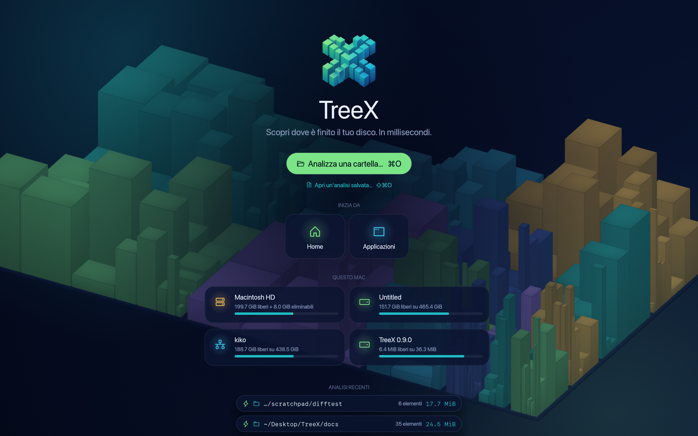

- **Analizza una cartella… (⌘O)**: scegli qualsiasi cartella.
- **Apri un'analisi salvata… (⇧⌘O)**: riapre un file `.treex` salvato con ⌘S (vedi [Salvare e riaprire un'analisi](#salvare-e-riaprire-unanalisi--s--o)).
- **Inizia da**: Home, Developer (se esiste), Applicazioni. Il badge **⚡ istantanea** indica che esiste già uno snapshot: l'apertura è immediata.
- **♥ Sostieni TreeX** (in basso a destra): apre la pagina GitHub Sponsors del progetto. TreeX è gratuito; lo stesso comando è nella palette ⌘K.
- **Questo Mac** (*Questo PC* su Windows, *Questo computer* su Linux): una scheda per ogni volume — il disco di avvio, i dischi esterni, le immagini disco montate e le condivisioni di rete — con lo spazio libero sul totale e una barra d'uso (corallo oltre il 90%). Sui volumi APFS compare anche lo **spazio eliminabile** (*X liberi + Y eliminabili*, la parte più chiara della barra): cache, istantanee locali di Time Machine e file di iCloud scaricati che macOS cancella da solo quando serve spazio. Il suggerimento della scheda del disco di avvio dice anche se ci sono istantanee locali di Time Machine. Un clic lo analizza; il disco di avvio viene analizzato attraverso il suo volume dati. Per le condivisioni di rete l'analisi legge tutto attraverso la rete e può richiedere molto tempo. I volumi di sistema nascosti (VM, Preboot, Recovery…) non compaiono. Su una finestra bassa la home mostra meno righe di dischi e di analisi recenti; quelli in più sono riassunti in *+ altri N* (elencati al passaggio del mouse).
- **Analisi recenti**: le ultime cartelle analizzate, con dimensione e numero di elementi, riaperte all'istante.

Sullo sfondo ruota una città isometrica: è lo stesso motore 3D che visualizzerà il tuo disco.

## La scansione

I contatori (elementi, spazio trovato, cartelle) partono sempre da 0 e salgono. Quando TreeX aggiorna un'analisi precedente invece di rifarla, sotto il titolo dice cosa sta facendo (carica l'analisi precedente, legge cosa è cambiato, aggiorna le cartelle cambiate); di solito dura meno di un secondo.

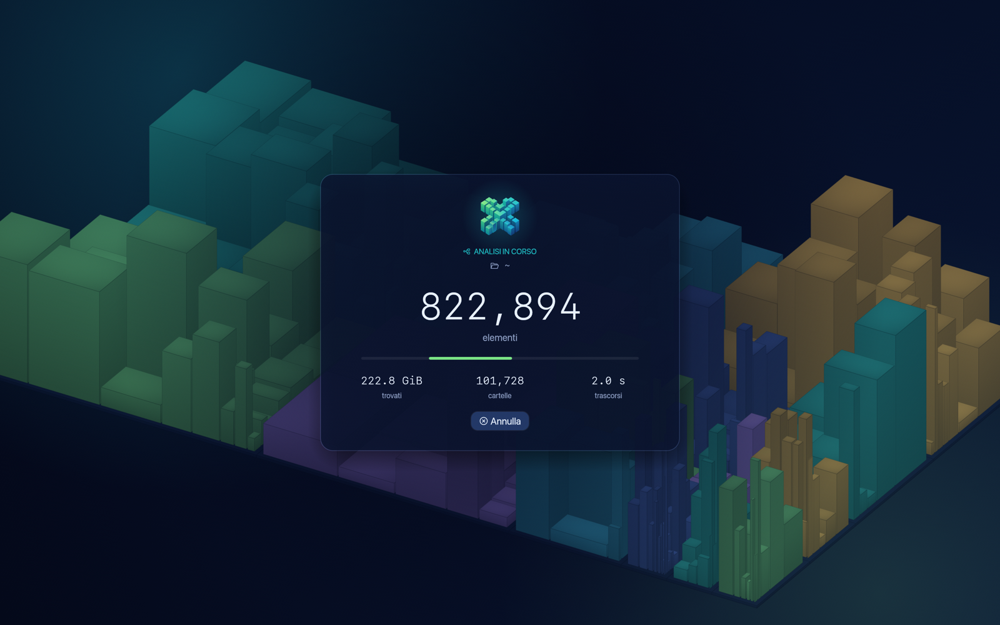

Contatori dal vivo di elementi, spazio trovato, cartelle e tempo trascorso. **Annulla** (o Esc) interrompe senza salvare risultati parziali.

## L'esploratore

La mappa occupa tutta la finestra: **ogni rettangolo è un file o una cartella, e la sua area è lo spazio che occupa su disco.** Le cartelle sono "terrazze" con il nome nell'intestazione; i file sono colorati per categoria (legenda in basso a sinistra).

### Due viste, un solo mondo — `Tab`

| 2D (precisione) | 2.5D (la città) |
|---|---|
| 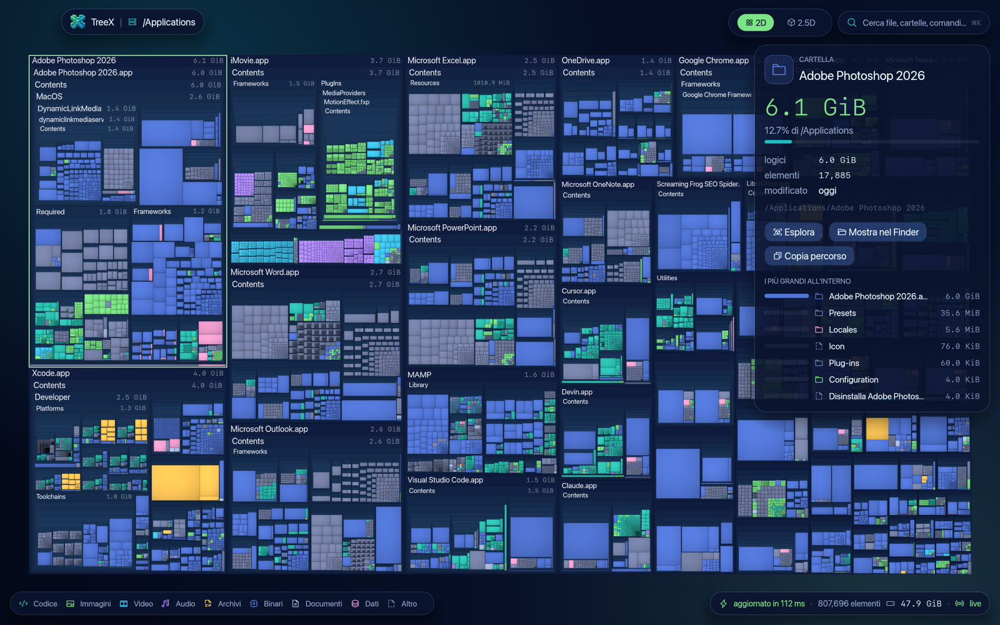 | 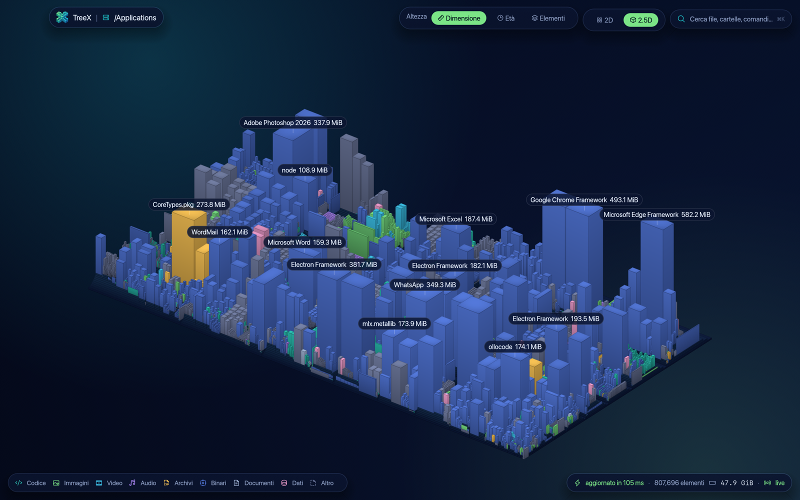 |

`Tab` (o il selettore in alto a destra) trasforma la mappa in una città isometrica con un'animazione continua: **la città si alza**. In 2.5D l'**altezza** degli edifici mostra una seconda informazione a scelta:

| Altezza | Significato | Tasto |
|---|---|---|
| Dimensione | più alto = più grande | `1` |
| Età | più alto = non modificato da più tempo (fino a 3 anni) | `2` |
| Elementi | più alto = cartella con più file | `3` |

### Modalità Reclaim: dove sta lo spazio sprecato — `4`

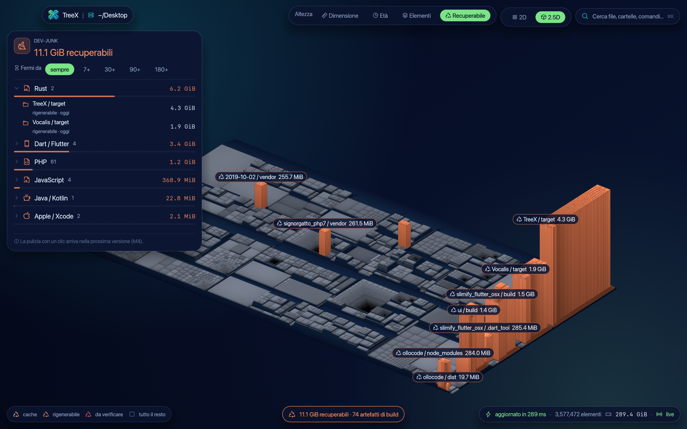

Scegli **Altezza → Recuperabile** (o premi `4`): la città diventa grigia e piatta, e da essa emergono solo le **torri corallo degli artefatti di build e delle cache** (`node_modules`, `target`, build Flutter, `DerivedData`, cache di npm, pip, Homebrew…). L'altezza di ogni torre è la dimensione dell'intero artefatto: **la più alta è lo spreco più grande**. Tre sfumature di corallo indicano la sicurezza: *cache* (si ricrea da sola), *rigenerabile* (si ricrea con un comando), *da verificare* (potrebbe contenere modifiche manuali, come un virtualenv).

**Pannello Dev-Junk** (`D`, oppure clic sull'indicatore corallo in basso "X GiB recuperabili"): artefatti per ecosistema con totale e quota, filtro **Fermi da** (sempre / 7+ / 30+ / 90+ / 180+ giorni di inattività del progetto), e un clic su una riga porta all'artefatto sulla mappa.

Quando selezioni un artefatto, l'inspector mostra un **banner corallo** con la regola riconosciuta, il comando per ricrearlo (es. `cargo build`, `npm install`, `flutter build`) e da quanto il progetto non viene toccato.

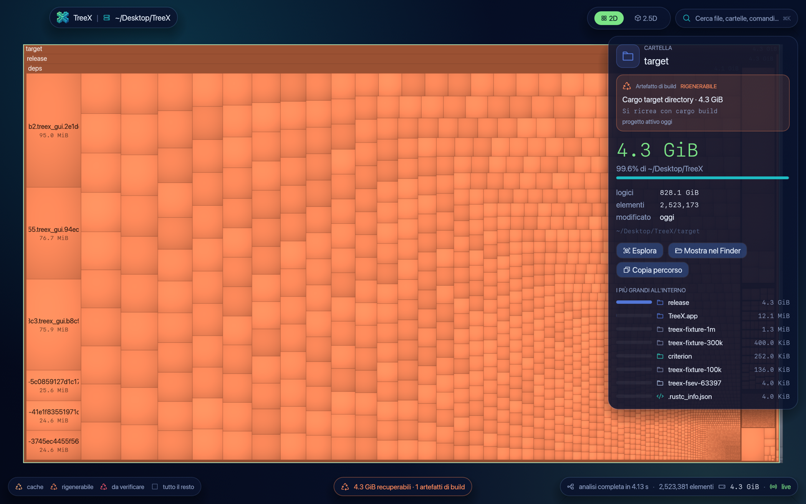

### Pulire in sicurezza

| Scegli | Conferma | Affonda | Fatto |
|---|---|---|---|
| 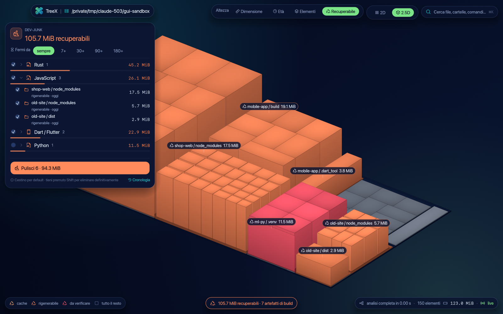 | 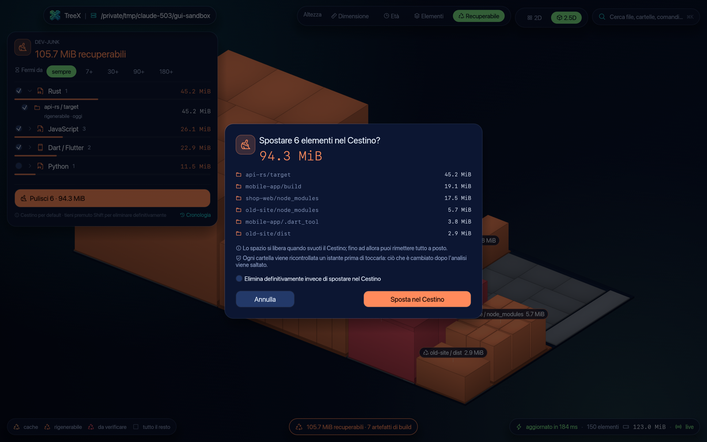 | 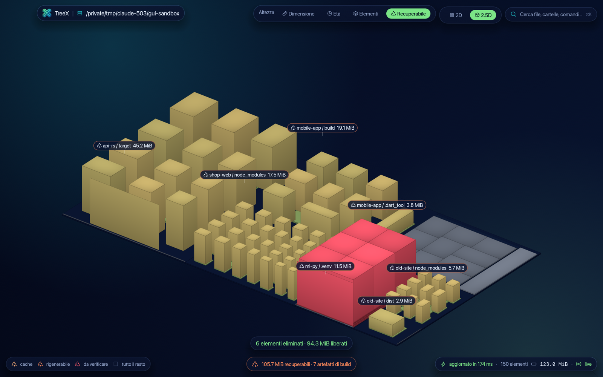 | 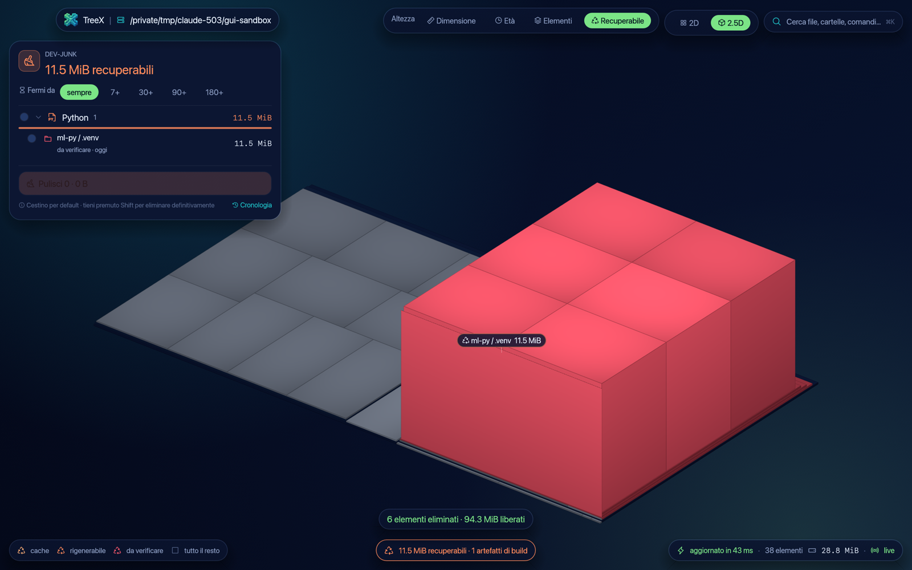 |

1. Nel pannello Dev-Junk spunta o togli gli elementi (o interi ecosistemi). Gli elementi sicuri (*cache*, *rigenerabile*) sono preselezionati; quelli *da verificare* (virtualenv) mai.
2. **Pulisci N · X GiB** apre la conferma: elenco, totale, e la scelta tra **Cestino** (default: reversibile, lo spazio si libera svuotandolo) ed **eliminazione definitiva**. Tieni premuto **Shift** mentre clicchi per partire direttamente dall'eliminazione definitiva. Anche il pulsante **Pulisci** nell'inspector di un singolo artefatto apre la stessa conferma.
3. Durante la pulizia ogni cartella viene ricontrollata un istante prima di toccarla (stessa cartella dell'analisi, non un collegamento, marker presenti, nessun repository git dentro): se qualcosa è cambiato viene saltata e lasciata intatta.
4. Le torri pulite **affondano** diventando menta, poi la mappa si aggiorna da sola.
5. **Cronologia**, in fondo al pannello o dalla palette ⌘K: le ultime pulizie, con l'esito di ciascuna.

Per personalizzare cosa viene riconosciuto vedi [Configurazione e regole](configuration.md).

### Tipi di file — `T`

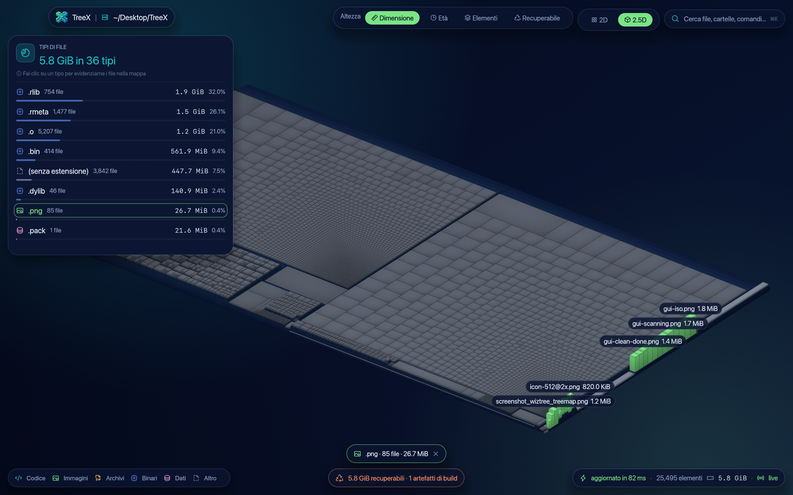

Il pannello **Tipi di file** raggruppa lo spazio dell'intera analisi **per estensione** (`.rlib`, `.png`, `.mov`…), dalla più pesante: dimensione su disco, percentuale e numero di file. Le maiuscole non contano (`.JPG` e `.jpg` sono lo stesso tipo); i file senza estensione e i dotfile (`.gitignore`) finiscono in *(senza estensione)*. Gli hard link si contano una volta sola, come nei totali delle cartelle.

**Fai clic su un tipo per evidenziarlo**: nella mappa, in 2D e in 2.5D, restano accesi solo i suoi file e le cartelle che li contengono; tutto il resto si abbassa e si spegne, e in 2.5D i tag compaiono solo sui file evidenziati. Una pillola in basso riassume il tipo evidenziato (file e spazio): la **✕**, o un secondo clic sullo stesso tipo, la toglie. L'evidenziazione resta anche chiudendo il pannello e navigando tra le cartelle.

### Duplicati — `U`

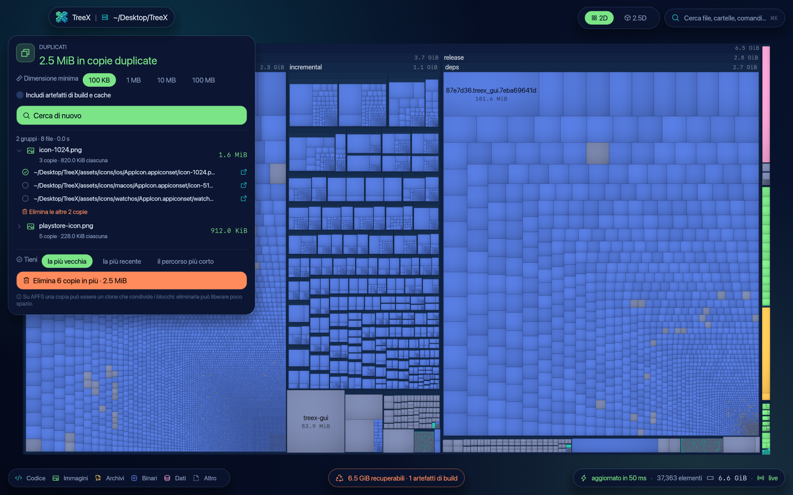

Il pannello **Duplicati** trova i file con **contenuto identico** in percorsi diversi.

1. Scegli la **dimensione minima** (100 KB, 1 MB — default —, 10 MB, 100 MB) e se **includere gli artefatti di build e le cache** (esclusi per default: `node_modules` e simili sono pieni di file identici che si rigenerano comunque).
2. **Cerca duplicati**. Il confronto procede per passi, leggendo il meno possibile: prima le dimensioni (già note, nessuna lettura), poi l'inizio e la fine dei file con la stessa dimensione, infine il contenuto completo solo dei file che coincidono ancora (hash BLAKE3). L'avanzamento mostra file confrontati e byte letti; **Annulla** si ferma subito.
3. I gruppi sono ordinati per **spazio sprecato** (lo spazio delle copie oltre la prima). Apri un gruppo per vedere tutte le copie: clic su un percorso per mostrarlo nella mappa, l'icona a destra per mostrarlo nel Finder.
4. **Scegli cosa tenere.** In ogni gruppo un cerchio pieno ✓ indica la copia che resta: per default la **più vecchia** (di solito l'originale); la regola si cambia in fondo al pannello (*la più vecchia*, *la più recente*, *il percorso più corto*) e per ogni gruppo si può scegliere a mano con un clic sul cerchio.
5. **Cloni APFS.** Una copia fatta sullo stesso volume (dal Finder, con `cp -c`, da molte app) è spesso un **clone**: condivide i blocchi con l'originale e occupa spazio una volta sola. TreeX lo rileva: le copie clonate hanno l'etichetta *clone*, la cifra di ogni gruppo è lo spazio che **si libera davvero** eliminando le altre copie (corallo se ci sono cloni), e in alto compare *si liberano davvero almeno X* quando è meno dello spazio delle copie. I gruppi sono ordinati per spazio realmente liberabile.
6. **Elimina.** *Elimina le altre N copie* in un gruppo aperto, oppure **Elimina N copie in più** per tutti i gruppi. Si apre la stessa conferma dell'eliminazione manuale (Cestino per default). Un istante prima di eliminare ogni copia, TreeX la **confronta di nuovo per intero** con quella che resta: se nel frattempo è cambiata, viene saltata.

Cosa non è un duplicato: gli **hard link** (sono lo stesso file), i collegamenti simbolici, i file vuoti. Un file modificato dopo l'analisi viene saltato e segnalato, mai riportato come duplicato.

> Su APFS una copia può essere un **clone** che condivide i blocchi con l'originale: risulta duplicata, ma eliminarla libera poco o nulla.

### Selezionare ed eliminare qualsiasi cosa

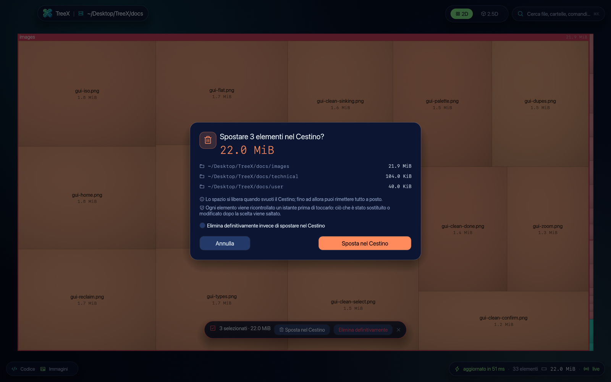

Oltre agli artefatti di build, TreeX elimina **qualsiasi file o cartella**:

- **⌘-clic** su un blocco della mappa (o su una riga della lista dei file) lo aggiunge alla selezione: diventa rosso, insieme a tutto ciò che contiene, e in basso compare una barra con il numero di elementi, lo spazio e le azioni. **Esc** annulla la selezione.
- **⌘⌫** sposta nel Cestino la selezione (o, senza selezione, l'elemento selezionato nell'inspector); **⌥⌘⌫** elimina definitivamente. Lo stesso dal menu contestuale e dal pulsante **Sposta nel Cestino** dell'inspector (con **Shift**: definitivamente).
- La **conferma** mostra gli elementi (nome e cartella), il totale, un avviso per le cartelle che contengono un **repository git** (la sua cronologia verrebbe persa) e la scelta tra Cestino ed eliminazione definitiva. In background misura anche lo spazio che **si libera davvero**: se alcuni file sono cloni APFS, lo dice (*N file condividono blocchi con cloni APFS: si libereranno davvero almeno X*).

Le stesse garanzie della pulizia degli artefatti: identità (device + inode) e tipo di ogni elemento vengono registrati alla conferma e ricontrollati un istante prima di toccarlo — un elemento sostituito, diventato un collegamento o cambiato di tipo viene saltato. Un **collegamento simbolico** viene rimosso come collegamento: ciò a cui punta non viene mai toccato. Alcuni percorsi sono **sempre protetti**: le cartelle di sistema (`/System`, `/Applications`, `/Library`, `/usr`…), la radice dei volumi, la Home e le sue cartelle principali (Scrivania, Documenti, Download, Libreria…), la cartella analizzata stessa. Tutto finisce nella **cronologia** (`treex history`), poi gli elementi eliminati affondano e la mappa si aggiorna.

### Menu contestuale

Tasto destro (clic, senza trascinare) su un blocco della mappa o su una riga della lista dei file: **Esplora** / **Apri**, **Quick Look** (anche `Spazio` sulla selezione), **Apri con…** (scegli un'app), **Mostra nel Finder**, **Ottieni informazioni** (la finestra Info del Finder: la prima volta macOS chiede il permesso di controllare il Finder), **Copia percorso**, **Seleziona**, **Sposta nel Cestino**, **Elimina definitivamente**.

### Lista dei file — `L`

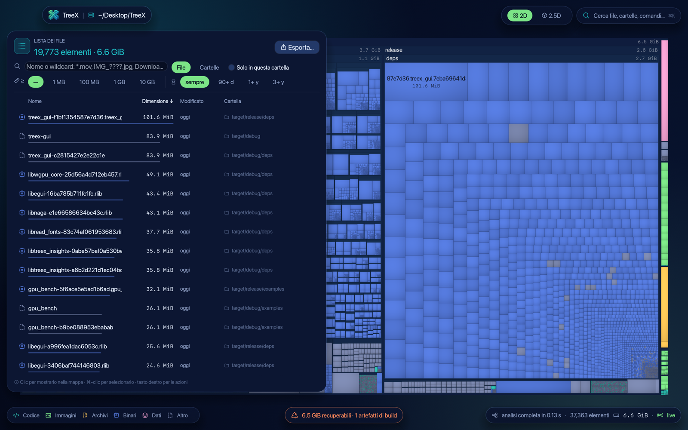

Tutti i file (o tutte le cartelle) dell'analisi in una tabella:

- **Cerca** per nome, anche con le wildcard: `*.mov`, `IMG_????.jpg`; con una `/` il filtro vale sul percorso (`Downloads/*.dmg`). Senza wildcard basta che il nome contenga il testo. Maiuscole e minuscole non contano.
- **Filtri**: dimensione minima (1 MB, 100 MB, 1 GB, 10 GB), non modificati da (90 giorni, 1 anno, 3 anni), *Solo in questa cartella* (quella che stai esplorando).
- **Ordina** con un clic sulle intestazioni (nome, dimensione, data, cartella); un secondo clic inverte.
- **Clic** su una riga per mostrarla nella mappa, **⌘-clic** per selezionarla, **tasto destro** per il menu contestuale. La lista è virtualizzata: scorre fluida anche con milioni di righe.
- **Esporta…** salva la lista, con i filtri attivi, in **CSV** o **JSON** (una riga per elemento: percorso, nome, tipo, estensione, dimensione, spazio su disco, data di modifica in UTC, elementi contenuti).

### Cosa è cambiato — `C`

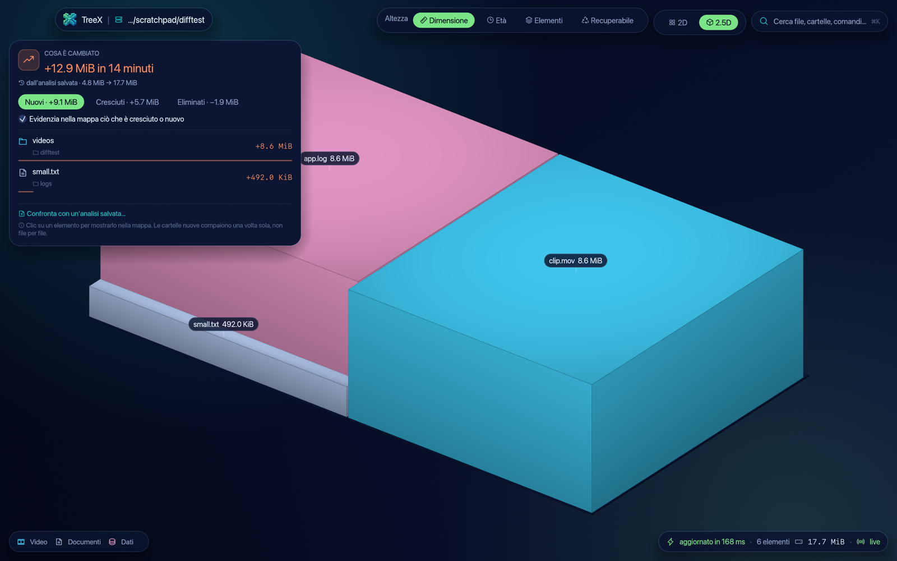

Confronta l'analisi che stai guardando con una precedente della stessa cartella e ti dice **quanto è cresciuta e perché**: *+12,4 MiB in 4 minuti*, *+3,2 GiB in 2 giorni*.

- **Non devi salvare niente**: TreeX ricorda da solo l'analisi precedente di ogni cartella, aggiornandola al massimo una volta al giorno. Alla prima analisi di una cartella il pannello spiega come funziona; dalla seconda il confronto è pronto. In alternativa, *Confronta con un'analisi salvata…* usa un file `.treex`.
- **Quattro schede** con i totali: **Nuovi**, **Cresciuti** (con le dimensioni prima e dopo), **Eliminati**, **Ridotti**. Una cartella nuova compare una volta sola, non file per file. Clic su un elemento per mostrarlo nella mappa (quelli eliminati non ci sono più).
- **Evidenzia nella mappa** accende solo ciò che è cresciuto o è nuovo, in 2D e 2.5D; tutto il resto si spegne.

### Salvare e riaprire un'analisi — `⌘S` / `⇧⌘O`

**⌘S** salva l'analisi corrente in un file `.treex` (lo stesso formato compatto e verificato degli snapshot); **⇧⌘O**, o *Apri un'analisi salvata…* nella home, la riapre in un istante, anche su un altro Mac. Un'analisi riaperta non osserva il disco (niente *live*): la barra di stato indica il file da cui viene. **⌘R** la sostituisce con un'analisi nuova della stessa cartella, se esiste su questo Mac. Dal terminale: `--save FILE` e `--from FILE`.

### Zoom con il dettaglio

Rotella o pinch per zoomare sul punto sotto il cursore, trascina per spostarti. Quando ti fermi, TreeX **ricalcola la mappa solo per la zona inquadrata**: compaiono i singoli file e i nomi delle sottocartelle che a zoom intero erano troppo piccoli (*zoom semantico*). Niente si sposta mentre il dettaglio appare.

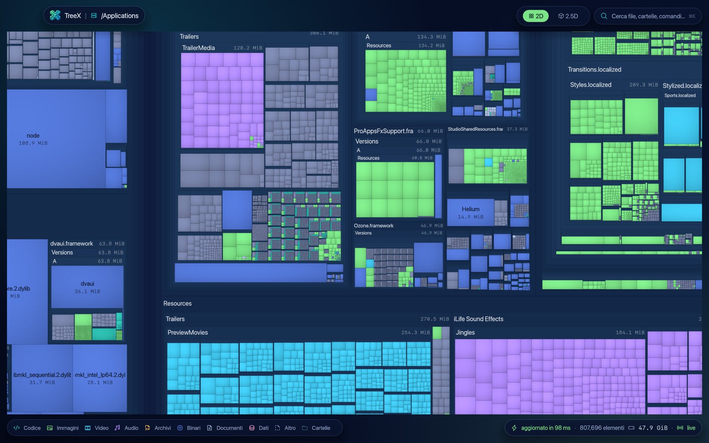

### Ruotare la città (2.5D)

In 2.5D, accanto a *2D / 2.5D* in alto a destra, ci sono **↺** e **↻**: ogni clic gira la città di 45° verso sinistra o verso destra, con un'animazione; i tasti **`Q`** ed **`E`** fanno lo stesso (anche dalla 2D, che passa in 2.5D). Per una rotazione libera: **due dita che ruotano sul trackpad** (macOS) oppure **trascina con il tasto destro** del mouse (su macOS anche ⌥ + trascina). `0` riporta la città all'angolo iniziale, per la via più breve, e reimposta zoom e posizione. Su una finestra stretta i pulsanti dell'altezza in alto mostrano solo l'icona e la ricerca solo la lente: il nome compare al passaggio del mouse.

### Navigare

| Azione | Come |
|---|---|
| Informazioni rapide | passa sopra un blocco |
| Selezionare (apre l'inspector) | clic |
| Entrare in una cartella | doppio clic, oppure `Invio` sulla selezione, oppure **Esplora** nell'inspector |
| Risalire | `Esc` / `Backspace`, oppure clic su un elemento del percorso in alto |
| Tornare alla home | clic sul logo TreeX in alto a sinistra |

### Inspector

Pannello a destra con dimensione su disco e logica, percentuale sulla cartella che lo contiene, numero di elementi, ultima modifica, percorso, e i **più grandi all'interno** (clic per selezionarli). Azioni: **Esplora**, **Mostra nel Finder**, **Apri** (file), **Copia percorso**, **Quick Look**, **Sposta nel Cestino**.

### Cerca tutto — `⌘K`

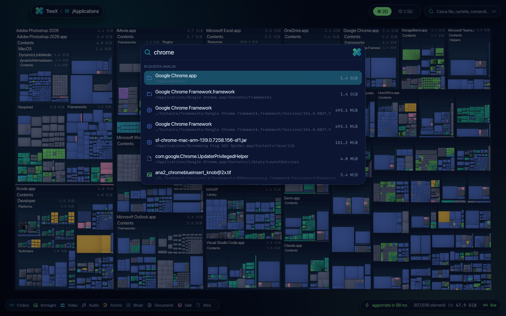

Scrivi per cercare **tra tutti i file e le cartelle dell'analisi** (ordinati per dimensione) e tra i comandi: cambiare vista o altezza, rianalizzare, analisi completa ignorando lo snapshot, cambiare lingua, tornare alla home… Frecce per scegliere, `Invio` per andare.

### Barra di stato e aggiornamenti dal vivo

In basso a destra: com'è stata ottenuta l'analisi (⚡ *aggiornato in N ms* dallo snapshot, *analisi completa*, oppure *analisi salvata* con il nome del file), elementi e spazio totale. **live** indica che TreeX sta osservando la cartella: se qualcosa cambia sul disco mentre l'app è aperta, la mappa si aggiorna da sola in pochi istanti, mantenendo la posizione e la selezione. Vale su macOS, Windows e Linux; si rileggono solo le cartelle cambiate. Su Linux una cartella con moltissime sottocartelle (oltre metà del limite di osservazione del sistema, `fs.inotify.max_user_watches`) non viene osservata e *live* non compare: un aggiornamento parziale potrebbe sbagliare senza dirlo.

### Legenda e filtri

La legenda in basso a sinistra elenca i colori delle categorie. Un clic su una categoria lascia accesi solo quei file (le cartelle che li contengono restano visibili, il resto si abbassa e si spegne) e mostra una pillola con numero di file e spazio; un nuovo clic o la ✕ della pillola tolgono il filtro. Su una finestra stretta la legenda mostra solo le icone: il nome compare al passaggio del mouse.

### Chiudere i pannelli

Ogni pannello (Dev-Junk, inspector, Tipi di file, Duplicati, Lista dei file, Cosa è cambiato) ha una ✕ in alto a destra; `Esc` chiude il pannello aperto (un secondo `Esc` deseleziona, un terzo risale di una cartella).

### Grafica fluida su ogni computer

TreeX misura quanto lavora la scheda grafica a ogni frame. Se una mappa molto grande è troppo pesante per la GPU (tipicamente una grafica integrata Intel con centinaia di migliaia di blocchi), riduce da sola l'antialiasing dei bordi (4× → 2× → 1×) per restare fluida, e lo ripristina sulle mappe più piccole. Sulle GPU potenti (Apple Silicon, NVIDIA, AMD) non cambia nulla: la grafica resta al massimo. Su una Intel UHD 620 una mappa di 143.000 blocchi gira a 60 fps sia in 2D sia in 2.5D.

### Il comando `treex` nel terminale

**⌘K → Installa il comando treex nel terminale** rende la riga di comando inclusa nell'app un comando del sistema, con le pagine `man` e il completamento con Tab: su macOS collega `/usr/local/bin/treex` alla copia dentro l'app (macOS chiede la password se serve), su Windows aggiunge al PATH dell'utente la cartella `bin` accanto a `TreeX.exe`, su Linux (AppImage) crea `~/.local/bin/treex`. Con Flatpak l'app spiega il comando da usare (`flatpak run --command=treex dev.treex.TreeX`). Poi, in un nuovo terminale, `treex tui` esplora una cartella come l'app ma nel terminale (vedi [Riga di comando](cli.md#treex-tui-path)).

### Aggiornare TreeX

In basso a destra nella home c'è **Aggiornamenti** (anche ⌘K → *Cerca aggiornamenti*, da qualsiasi schermata). TreeX non controlla mai da solo: solo a quel clic chiede a GitHub qual è l'ultima release.

- **Sei già all'ultima versione**: lo dice e basta.
- **C'è una versione nuova**: una finestra mostra le novità e il pulsante **Aggiorna e riavvia**. TreeX scarica il pacchetto per il tuo sistema, controlla che sia **autentico** (la lista dei checksum della release è firmata con una chiave che solo chi pubblica TreeX possiede) e **integro** (il checksum del file scaricato), poi sostituisce l'app e si riapre. Se un controllo fallisce non installa nulla. Il download si può annullare; *Più tardi* chiude la finestra e la pillola in home resta verde (*TreeX X disponibile*) finché l'app è aperta.
- **macOS**: dopo l'aggiornamento macOS chiede di nuovo l'accesso completo al disco (vedi [Permessi su macOS](macos-permissions.md)), perché le build non sono firmate con un certificato Apple.
- **Windows**: installato con l'installer, TreeX scarica il nuovo installer, ne verifica firma e checksum e lo avvia in silenzio (le scelte fatte all'installazione restano, la versione in *App installate* è quella giusta), poi si riapre. Con lo zip, i file vecchi restano accanto ai nuovi con estensione `.old` e vengono cancellati al riavvio successivo.
- **Linux**: l'AppImage viene sostituita (con la nuova versione nel nome, se avevi tenuto quello originale); l'archivio installato con `install.sh` aggiorna `treex-gui` e `treex`.
- **Quando serve il download a mano**, la finestra lo spiega e apre la pagina della release: Flatpak (che non permette alle app di aggiornarsi da sole), una cartella in cui TreeX non può scrivere (ad esempio `C:\Program Files` senza essere amministratore), macOS che esegue l'app da una copia temporanea (sposta TreeX in Applicazioni), TreeX compilato dai sorgenti.

## Scorciatoie

| Tasto | Azione |
|---|---|
| `⌘O` | apri cartella |
| `⌘K` | cerca / comandi |
| `⌘R` | rianalizza |
| `Tab` | 2D ⇄ 2.5D |
| `1` `2` `3` `4` | altezza: dimensione / età / elementi / recuperabile |
| `D` | pannello Dev-Junk |
| `T` | tipi di file (spazio per estensione) |
| `U` | duplicati |
| `L` | lista dei file |
| `C` | cosa è cambiato dall'analisi precedente |
| `⌘`-clic | seleziona / deseleziona |
| `Spazio` | Quick Look dell'elemento selezionato |
| `⌘⌫` / `⌥⌘⌫` | sposta nel Cestino / elimina definitivamente |
| `⌘S` / `⇧⌘O` | salva l'analisi / apri un'analisi salvata |
| `Q` / `E` | ruota la città 2.5D di 45° a sinistra / a destra |
| `0` | reimposta la vista |
| `Invio` | entra nella cartella selezionata |
| `Esc` / `Backspace` | deseleziona (anche la selezione multipla) / risali |

## Privacy

TreeX usa la rete solo quando clicchi **Aggiornamenti** (una richiesta a GitHub, più il download se scegli di aggiornare): nessun dato su di te o sul disco viene inviato. L'analisi legge solo i metadati (nomi, dimensioni, date). Il contenuto dei file viene letto solo quando avvii una **ricerca di duplicati**, e solo per i file che hanno la stessa dimensione di un altro; nulla viene salvato o inviato. Per le cartelle protette di macOS vedi [Permessi su macOS](macos-permissions.md).
